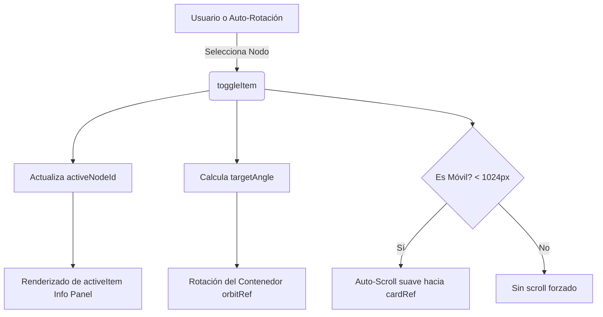

# UI System

Este documento describe los componentes visuales clave utilizados en el ecosistema de la web pública (EnergyEngine / Corporación Maresa).

## Radial Orbital Timeline (`radial-orbital-timeline.tsx`)

Este componente renderiza una línea de tiempo orbital y animada, diseñada bajo los principios de *Luxury UI* y *Generative Engine Optimization (GEO)*.

### Características Principales
- **Animación Continua (RequestAnimationFrame):** El componente rota 12.85 grados por segundo, logrando que cada tarjeta sea visible por exactamente 7 segundos en su fase activa, reemplazando temporizadores menos precisos.
- **Auto-Activación Matemática:** Determina el nodo activo calculando la distancia mínima respecto a los 0 grados (posición equivalente a las 3 en un reloj).
- **Consistencia Visual:** Las tarjetas de información poseen una altura estrictamente fijada (e.g. `h-[380px]` en escritorio y `h-[420px]` en móvil), evitando saltos de *layout shift (CLS)* durante la navegación.
- **Comportamiento Responsivo Avanzado:**
  - En versión de escritorio, el componente utiliza una estructura `flex-row` dividida en mitades.
  - En dispositivos móviles, la jerarquía visual se altera para mostrar el encabezado explicativo *antes* del carrusel orbital.
  - Implementa un "Auto-Scroll" semántico: al interactuar con un nodo en celular, la pantalla se desliza suavemente (`scrollIntoView`) hacia la tarjeta de información inferior para mejorar la UX y minimizar fricción.
  
### Dependencias
- `lucide-react` (iconografía semántica)
- Componentes base Shadcn UI (`Badge`, `Button`, `Card`)

### Mermaid Diagram de Interacción

## Relación con otros módulos
Ver también: [[01_Nosotros_Page]]
